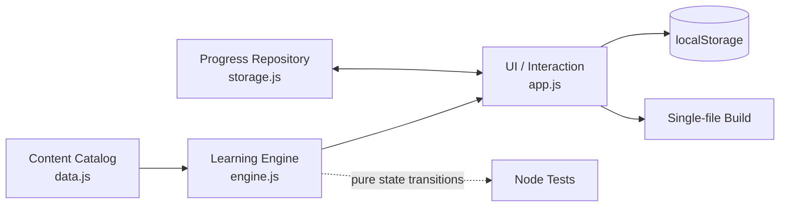

# 知屿 · 暗夜学习营地

> 把知识卡、每日打卡、成长等级、成就徽章与奖励兑换，做成一个可以离线运行的像素学习游戏。

[在线体验](https://tommyducx.github.io/zhiyu-study-camp/) · [在线架构报告](https://tommyducx.github.io/zhiyu-study-camp/docs/architecture-review.html) · [架构说明](docs/ARCHITECTURE.md) · [领域词汇](GLOSSARY.md)


## 它是什么

知屿是一个 **local-first** 的单页学习应用。它把复习行为变成看得见的成长：每翻一张知识卡、掌握一个知识点、完成一次打卡，都会带来 XP、叶币和营地变化。

- **30 张真实高中知识卡**：语文、数学、物理、化学、生物五科，可搜索、筛选、记录查看次数、最近学习时间和掌握状态。
- **每日航线**：打卡、复习三张不同卡片、掌握一个知识点，三项完成可开启营地宝箱。
- **成长系统**：二次曲线等级、连续打卡、8 个自动解锁成就、4 类奖励兑换与完整成长流水。
- **本机账号**：支持注册、登录、访客进度迁移；经验、金币、成就和记录均按账号独立保存。
- **暗夜地牢 × 手账视觉**：石板网格、黑曜石面板、三层像素描边、暖金高光、HUD 三条状态槽与可交互营地宝箱。
- **离线优先**：无需后端。`dist/index.html` 是完全自包含的单文件版本，直接双击即可运行。

## 快速开始

### 直接体验

打开 [`index.html`](index.html)，或在项目目录启动任意静态文件服务器：

```bash
python3 -m http.server 8080
# 访问 http://localhost:8080
```

`file://` 协议也可以直接运行，不依赖网络。

### 开发与验证

项目无运行时依赖，只需要 Node.js 20+：

```bash
npm test       # 14 条领域与仓储规则测试
npm run build  # 生成 dist/index.html
npm run check  # 校验离线产物与内容目录
npm run verify # 测试 + 构建 + 校验
```

### 单文件交付

```bash
npm run build
# 产物：dist/index.html
```

`dist/index.html` 内联全部样式、内容与脚本，不请求 CDN、字体或图片，适合本地保存、邮件分享或离线使用。

## 项目结构

```text
zhiyu-study-camp/
├── index.html              # 开发入口，加载独立资源
├── assets/styles.css       # 视觉系统与响应式规则
├── src/
│   ├── data.js             # 30 张知识卡、成就与奖励目录
│   ├── engine.js           # 深层学习引擎：奖励、打卡、等级、成就
│   ├── storage.js          # localStorage 仓储适配器
│   └── app.js              # DOM 渲染、账号与交互编排
├── scripts/
│   ├── build.mjs           # 源文件 → 自包含单文件
│   └── check.mjs           # 产物、内容与离线约束校验
├── tests/engine.test.js    # 领域规则单元测试
├── dist/index.html         # 可直接打开的单文件构建
└── docs/                   # 架构报告、模块地图、ADR
```

## 架构



核心规则集中在 `engine.js`：调用方只需要通过 `openCard`、`setStatus`、`checkIn`、`openChest`、`redeem` 与 `snapshot` 这一小组操作，不需要知道奖励去重、每日委托、成就判定和等级曲线如何实现。界面层只负责渲染和反馈。

详细设计见 [ARCHITECTURE.md](docs/ARCHITECTURE.md)，模块职责与数据流见 [CODE-MAP.md](docs/CODE-MAP.md)。

## 数据与隐私

- 所有学习数据保存在浏览器 `localStorage`，不会上传任何服务器。
- 本机账号使用随机盐 + 浏览器 Web Crypto 的 SHA-256 摘要，仅用于区分同一浏览器内的不同学习者，**不构成生产级身份认证**。
- 清理浏览器数据前，请在「我的档案 → 数据备份」中导出 JSON。
- 不包含任何教材 PDF、试卷原文件或第三方游戏素材。

## 授权

代码以 [MIT License](LICENSE) 发布。视觉方向致敬像素地牢与农场模拟游戏，但不包含其商标或素材。
