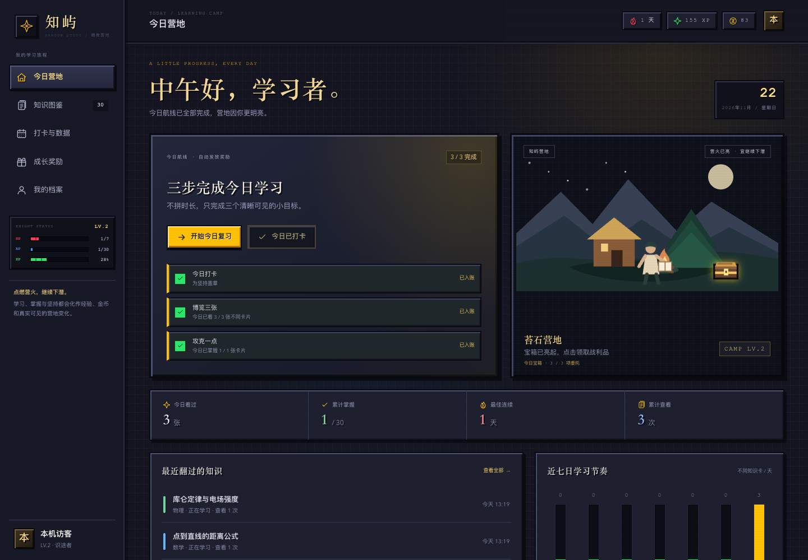
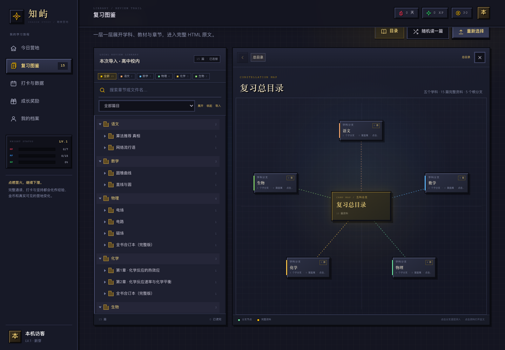
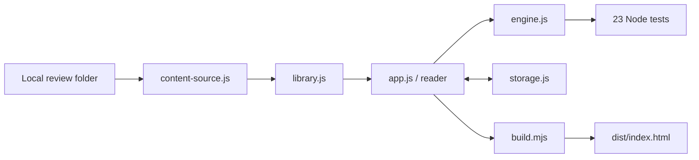

# 知屿 · 暗夜学习营地

[](https://github.com/TommyDucx/zhiyu-study-camp/actions/workflows/ci.yml)

> 把完整复习资料做成一座可探索的知识营地：逐层展开目录、通读全文、点亮营火、升级角色。

[在线体验](https://tommyducx.github.io/zhiyu-study-camp/) · [在线架构报告](https://tommyducx.github.io/zhiyu-study-camp/docs/architecture-review.html) · [架构说明](docs/ARCHITECTURE.md) · [代码导图](docs/CODE-MAP.md)





## 它是什么

知屿是一个 **local-first** 的复习资料阅读器与习惯养成应用。它不把复习内容拆成零散知识卡，而是直接连接你本机的完整 HTML 复习库，按「学科 → 教材 / 专题 → 章节 → 全文」逐层展开。

- **两种找路方式**：默认是可折叠的 outline 目录，可按学科筛选；也可以切到「星图」，从五科总览进入，一层一层点击分支，直到打开全文。
- **完整目录阅读**：浏览器递归读取复习文件夹，建立分层目录；点击条目后在右侧打开完整 HTML 原文。
- **通读才算数**：页面从顶部滚到最后才记为一次通读。只打开不滚动、停在半途，都不会发奖励。
- **可核验的成长**：每次通读、每日委托、连续打卡、成就与兑换都有独立幂等账本，刷新不丢、重复不刷。
- **暗夜营地角色**：原创像素旅人「拾光旅人」、苔猫伙伴、木箱 / 铁箱 / 金箱三阶段宝箱与火把营地。
- **本机账号**：注册、登录、访客进度迁移，数据按账号隔离保存在浏览器。
- **隐私优先**：复习 HTML 只通过浏览器目录权限读取，**不会复制进仓库或上传服务器**。

## 连接你的复习库

### 直接打开

双击项目根目录的 [`知屿学习营地.html`](知屿学习营地.html)，或打开 [`dist/index.html`](dist/index.html)。这两个文件每次构建都会同步更新，内容完全相同，可以直接离线运行。

也可以启动本地服务器开发调试：

```bash
python3 -m http.server 8080
# 打开 http://localhost:8080
```

### 连接目录

1. 进入「复习图鉴」，点击「连接资料库」。
2. 选择包含 `语文 / 数学 / 物理 / 化学 / 生物` 的上级文件夹（例如整个 `高中校内`），或选择单个学科文件夹。

支持 Chrome / Edge 的目录权限持久化；再次打开只需恢复授权。Safari / Firefox 可点击目录栏的「导入」临时选择文件夹，刷新后需要重选，但通读记录会保留。

扫描会识别完整复习资料，并自动排除：

- 打印版、原页扫描、讲义原页等重复或非全文衍生页面；
- `绘图工具 / 原稿备份 / _work / node_modules` 等中间目录；
- HTML 之外的 PDF、图片与脚本。

当前个人资料库的实测结果：**110 个 HTML 中识别出 99 篇完整复习资料、50 个层级目录**，按五科分布为语文 2、数学 7、物理 14、化学 28、生物 48。

## 奖励规则

| 行为 | 经验 | 叶币 | 发放条件 |
| --- | ---: | ---: | --- |
| 首次通读一篇资料 | +15 | +4 | 从顶部滚动到底部，每篇只发一次 |
| 精读一篇 | +30 | +10 | 每个自然日读完第一篇 |
| 再读一篇 | +25 | +8 | 同一自然日读完第二篇 |
| 今日打卡 | +20 | +10 | 每天一次 |
| 完成全部每日委托 | +40 | +15 | 打卡 + 读一篇 + 再读一篇 |
| 开启今日宝箱 | +20 | +10 | 三项委托完成后点击宝箱，每天一次 |

首次通读奖励永久幂等；同一天重读同一篇会累计通读次数，但不会重复发放首次奖励。成就根据通读篇数、覆盖学科、连续打卡和等级自动解锁。

## 开发与验证

无运行时依赖，需要 Node.js 20+：

```bash
npm test       # 23 条领域、仓储、目录索引测试
npm run build  # 生成 dist/index.html 和根目录单文件入口
npm run check  # 校验离线产物、完整阅读器与内容规则
npm run verify # 测试 + 构建 + 校验
```

`npm run build` 会把样式、游戏目录、学习引擎、目录索引、内容适配器与 UI 内联成一个约 211 KB 的单文件，并同时写入根目录 `知屿学习营地.html` 与 `dist/index.html`。它是可离线启动的应用外壳；完整复习内容始终来自你本机选择的文件夹。

## 项目结构

```text
zhiyu-study-camp/
├── 知屿学习营地.html          # 最新可双击单文件（每次构建自动更新）
├── index.html                  # 开发入口
├── assets/
│   ├── styles.css              # 暗夜营地、目录树、阅读器与响应式
│   └── characters/             # 原创像素角色、苔猫、宝箱素材
├── src/
│   ├── data.js                 # 学科、成就、奖励、等级名称
│   ├── engine.js               # 深层学习引擎：通读、日常、宝箱、成就
│   ├── storage.js              # 本机账号与进度仓储适配器
│   ├── library.js              # 文件路径 → 分层复习目录
│   ├── content-source.js       # 本机文件夹 / 目录句柄读取
│   └── app.js                  # DOM 渲染、账号与阅读器编排
├── scripts/
│   ├── build.mjs               # 自包含单文件构建与二次校验
│   └── check.mjs               # 产物、目录规则与离线约束校验
├── tests/
│   ├── engine.test.js          # 阅读奖励与幂等规则
│   ├── library.test.js         # 目录过滤、标题和层级
│   ├── storage.test.js         # 账号与进度隔离
│   └── fixtures/               # 浏览器烟测用最小资料库
├── dist/index.html             # GitHub Pages / 单文件构建
├── legacy/                     # 本地旧原型备份（不进入公开仓库）
└── docs/                       # 架构报告、模块地图、ADR、美术说明
```

## 架构



界面与测试共用同一个学习引擎 **接口**。阅读器只上报“到达底部”，不自行决定 XP、每日委托或宝箱能否领取；这些规则都在 `engine.js` 的奖励账本后面。

详细设计见 [ARCHITECTURE.md](docs/ARCHITECTURE.md)，模块职责、数据模型与扩展位置见 [CODE-MAP.md](docs/CODE-MAP.md)，视觉与素材来源见 [ART-DIRECTION.md](docs/ART-DIRECTION.md)。

## 数据与隐私

- 学习进度保存在浏览器 `localStorage`；完整复习 HTML 只在本机内存中读取。
- 目录句柄保存在 IndexedDB，仅用于下次请求恢复读取权限，不包含文件内容。
- 本机账号使用随机盐 + Web Crypto SHA-256 摘要，仅用于区分同一浏览器中的学习者，**不是生产级身份认证**。
- 清理浏览器数据前，请在「我的档案 → 数据备份」中导出 JSON。

## 素材与授权

角色、苔猫、宝箱、界面图形均为本项目的**原创像素风 SVG**。视觉氛围参考了《星露谷物语》的农场手账与《元气骑士》的地牢 HUD，但仓库不包含两款游戏的原版立绘、贴图、商标或音频。

代码以 [MIT License](LICENSE) 发布。
