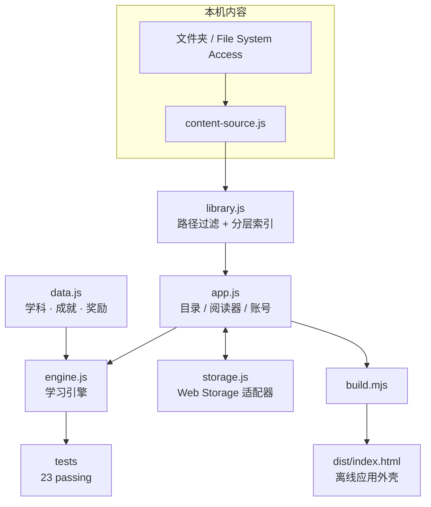
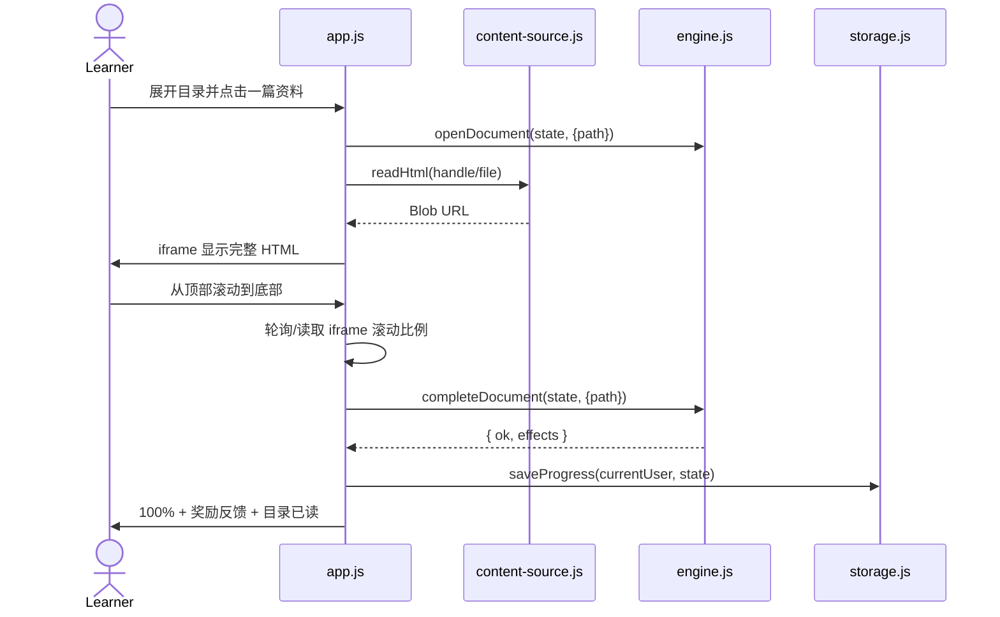

# 架构说明

## 1. 设计目标

知屿要同时满足四种要求：

1. **读完整内容**：直接打开复习 HTML 原文，而不是把内容二次切碎。
2. **本机隐私**：完整笔记留在本机；public 仓库不携带任何复习资料。
3. **可核验奖励**：只有从顶部滚动到底部才算通读；重复访问不能刷奖励。
4. **可维护、可携带**：源码分层，仍能构建成可离线启动的单文件应用。

## 2. 模块图



## 3. 核心接缝

### 3.1 两种目录导航

界面层提供两种互相独立、最终都落到 `openDocument(path)` 的导航方式：

- **大纲（Outline）**：左侧按学科分 tab，每个学科内部是可折叠的「教材 / 专题 → 章节 → 文档」树。适合按顺序扫读和搜索。
- **星图（Constellation）**：右侧以当前层级为中心节点，子目录与文档围绕成一个可点击的网状图；点击分支进入下一层，面包屑与返回按钮可随时退回。适合从模糊记忆逐层定位。

两者都不持有奖励规则：它们只改变“显示的层级”和最终传入的文档路径。星图层级保存在 UI 的 `graphTrail` 中，不写入学习进度。

### 3.2 学习引擎

**模块**：`createEngine({ achievements, rewards, levelNames, subjects })`

**接口**：

| 操作 | 责任 | 奖励 |
| --- | --- | --- |
| `openDocument(state, opts)` | 记录打开次数、最近打开时间 | 不发 |
| `completeDocument(state, opts)` | 记录一次完整通读，计入当日唯一篇目 | 首次通读 + 每日委托 |
| `checkIn(state, opts)` | 打卡、连续天数 | 打卡奖励 |
| `openChest(state, opts)` | 校验三项每日委托 | 宝箱奖励 |
| `redeem(state, opts)` | 扣币、库存、兑换记录 | 不发 |
| `snapshot(state)` | 给 UI 的只读汇总 | — |

**关键不变量**：

- `openDocument` 永不发放阅读奖励；只有 `completeDocument` 能记一次通读。
- `awarded` 账本以 `read:<path>`、`quest:read1:<day>`、`chest:<day>` 等键保证幂等。
- 同一天重读同一篇会累加 `reads`，但不会重复计入当日委托，也不会重复发首次奖励。
- 所有操作允许注入 `at`，因此跨日、跨月、连续打卡可以脱离浏览器测试。

### 3.3 分层索引

**模块**：`ZYLibrary`（`src/library.js`）

接收文件路径，不读取文件内容，输出：

```js
{ tree, documents, total, ignored, folders }
```

职责包括：

- 将选择根目录后的路径归一化到五科之一；
- 排除打印版、原页扫描、备份、中间构建目录；
- 按「学科 → 教材 / 专题 → 章节」建树；
- 从文件名提取可读标题与标签（全书 / 速览 / 完整 / 图谱）。

这是纯函数模块，Node 可以直接测试真实路径，不需要浏览器。

### 3.4 内容来源适配器

**模块**：`ZYContentSource`

当前有两个真实**适配器**：

1. File System Access 目录句柄：支持持久授权；
2. `<input webkitdirectory>` 的 `FileList`：不支持目录句柄时的会话级回退。

两者都产出相同的 `records[]` 形状。这不是假想接缝，因为已经有两个实际变化来源。

完整 HTML 不进入 `localStorage`：目录句柄只保存在 IndexedDB；打开文档时读取文本并生成 Blob URL，关闭时立即撤销。

### 3.5 进度仓储

`createStore(storage)` 仍只封装账号、会话和按学习者分隔的进度。学习规则和文件内容都不经过它。

## 4. 阅读与完成流程



滚动完成由注入资料页末尾的一小段 **阅读桥** 上报：它在沙箱 iframe 中读取文档根滚动区与大型内部滚动容器，通过 `postMessage` 发送比例；父页面校验 iframe source 与一次性 token 后才调用 `completeDocument`。父页面不直接访问 iframe DOM，也没有把账号存储暴露给资料页。短文档在停留足够时间后视为读完；阅读桥没有回传时，应用会明确显示提示，不会伪造完成。

## 5. 数据模型

```text
version=3, xp, coins, lastLevel, createdAt
profile { name, bio, theme }
documents[path] { opens, reads, lastOpen, lastRead, title, subject }
checkins[YYYY-MM-DD] { ts }
daily[YYYY-MM-DD] { reads: [path] }
achievements[id] = unlockedAt
awarded[key] = grantedAt
rewards[id] = count
redemptions[] / transactions[]
```

路径是文档的稳定 ID。目录迁移时路径会变，历史记录不会自动映射；这是当前版本接受的范围。

## 6. 测试

```bash
npm test
```

共 23 条：

- 12 条学习领域规则：打开、通读、重复、每日委托、宝箱、连续、五科成就、兑换、规范化、等级、日期；
- 7 条目录索引规则：根路径归一化、过滤、标题、层级、重复、搜索、排序；
- 4 条仓储规则：账号、会话、用户隔离、异常回退。

浏览器验证使用真实 Chromium，已验证：

- 导入含两科的文件夹后，目录树正确显示 2 篇；
- Blob iframe 可访问 `contentWindow`，滚动到底触发 100%；
- 读完两篇 + 打卡后，3/3 委托、宝箱启用并正确发放；
- 390px 视口无横向溢出，阅读器全屏且不与底部导航重叠。

尚缺：把浏览器烟测固定为 CI 的 Playwright job。

## 7. 已知边界

- **本机账号不是安全边界**：拥有浏览器存储访问权的人可以修改进度。
- **资料页是用户自己的 HTML**：它运行在没有 `allow-same-origin` 的 sandbox iframe 中，无法读取父页面账号存储；但它仍可向父页面回传伪造的滚动比例。完成记录适合个人习惯，不足以承载可兑换真实权益的防作弊。
- **目录路径是身份**：重命名文件或移动目录会被视为新文档，之前的通读记录不会跟随。
- **多标签页写入采用最后写入者覆盖**：尚无语义合并或冲突解决。
- **Safari / Firefox 不持久保存目录句柄**：刷新后需要重新选择文件夹，但通读记录会保留。
- **没有服务端校验**：若未来开放排行榜、真实奖品或多人竞争，奖励规则必须迁到可信服务端。

## 8. 架构决策记录

- [ADR-0001：本地优先与单文件交付](adr/0001-local-first-single-file.md)
- [ADR-0002：以学习引擎作为领域接缝](adr/0002-learning-engine-seam.md)
- [ADR-0003：复习内容不进入公开仓库](adr/0003-local-content-boundary.md)
