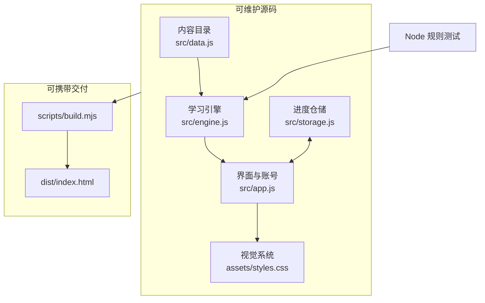
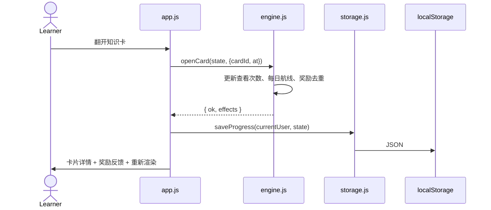

# 架构说明

## 1. 设计目标

知屿需要同时满足三种互相拉扯的要求：

1. **可直接使用**：用户双击一个 HTML 文件就能离线学习。
2. **可持续修改**：新增知识卡、规则或主题时，不应在 1000 多行的单文件里寻找调用点。
3. **可验证**：奖励是否重复、连续打卡是否跨月正确、兑换是否会透支，必须能脱离浏览器测试。

因此项目把“**可维护的源结构**”和“**可携带的发布产物**”分开：`src/` 是可读的源代码，`dist/index.html` 是由构建器生成的自包含交付物。



## 2. 核心接缝

### 2.1 学习引擎

**模块**：`createEngine({ cards, achievements, rewards, levelNames })`

**接口**只有以下操作：

| 操作 | 责任 | 是否修改状态 |
| --- | --- | --- |
| `defaultState()` | 创建干净进度 | 否 |
| `normalize(raw)` | 迁移旧数据、移除未知 ID、约束字段 | 否 |
| `openCard(state, opts)` | 记录查看与首次查看奖励 | 是 |
| `setStatus(state, opts)` | 修改掌握状态与首次掌握奖励 | 是 |
| `checkIn(state, opts)` | 打卡与连续统计 | 是 |
| `openChest(state, opts)` | 校验每日航线并发放宝箱 | 是 |
| `redeem(state, opts)` | 扣币、库存、兑换记录 | 是 |
| `snapshot(state)` | 给 UI 的只读汇总 | 否 |
| `reconcile(state, opts)` | 补齐历史数据中应得的成就 | 是 |

每个变更操作返回：

```js
{ ok: true, effects: [{ kind: 'reward', title, xp, coins }] }
```

`effects` 是界面反馈的唯一来源。UI 不重新判断“这是不是首次掌握”“宝箱有没有开过”，只负责把事件变成 toast、动画和重新渲染。

**为什么这是一个深层模块**：调用方不需要了解 12 个奖励键、成就指标映射、二次等级曲线、每日奖励顺序或跨日规则；它只需要知道六个动作和一种结果形状。所有实现细节都在同一个模块里，修改规则不需要搜索 DOM 事件处理器。

### 2.2 进度仓储

**模块**：`createStore(storage)`

它把 Web Storage 的 JSON 读写、损坏数据回退、账号、会话和按用户分隔的进度键封装在一个小接口后面。它的**接缝**允许未来替换为：

- IndexedDB（更大容量、多标签页协调）
- 加密存储
- 远端同步适配器

当前只有 Web Storage 一个**适配器**，所以这个接缝主要是为隔离和测试准备的，而不是宣称已经需要多后端。

### 2.3 内容目录

`src/data.js` 是冻结的内容目录。成就不再携带可执行闭包，而使用声明式指标：

```js
{ id: 'master5', metric: 'mastered', target: 5, xp: 50, coins: 20 }
```

引擎在初始化时校验重复 ID 和未知指标。新增成就时无需改判定算法，只需增加一条定义。

## 3. 数据流



日期统一使用本地自然日 `YYYY-MM-DD`；所有写操作接受可注入的 `at`，因此测试能稳定覆盖跨日、跨月和重复行为。

## 4. 可测试性

领域层不访问 `document`、`window` 或 `localStorage`，所以 Node 可以直接调用同一个 `engine.js`：

```bash
npm test
```

现有测试覆盖：

- 首次查看奖励只发一次，但查看次数持续累加；
- 每日航线只在条件满足时完成，重复打卡不重复发奖；
- 掌握奖励永久防重复，状态切换不能刷每日委托；
- 宝箱未完成时锁定，完成时只开一次；
- 连续打卡跨日计算；
- 兑换余额、一次性权益和可重复奖励；
- 旧数据规范化与未知 ID 移除；
- 等级边界、本地日期与跨月日期计算。

界面层仍以 DOM 操作为主，尚未建立浏览器自动化测试。这是下一步可深化点，而不是已解决事项。

## 5. 构建策略

`scripts/build.mjs` 做三件事：

1. 将 CSS 与四个脚本按依赖顺序内联进 `index.html`；
2. 用函数式替换避免 `$$` 等 `$` 序列被 `String.replace` 误解释；
3. 对最终嵌入的每段脚本重新做一次语法编译，并检查不存在外链。

这使发布产物可以完全离线，同时保留 `src/` 的正常可读、可 diff 源文件。

## 6. 已知边界

- **账号不是安全边界**：纯本机 SHA-256 摘要只能避免明文密码，不能抵抗能访问同一浏览器存储的人。
- **没有多标签页合并**：两个标签页同时写入时，最后写入者覆盖先前状态。未来若增加同步，应先引入版本号与冲突策略。
- **界面层仍然是单体**：渲染函数集中在 `app.js`。下一步应按页面拆成独立的 render 模块，但应在真实改动压力出现时再拆，避免为拆而拆。
- **未接入 CRDT / 网络同步**：local-first 是当前产品约束，不是待补的漏洞。
- **没有服务端安全校验**：本机奖励可被用户手动修改；在引入排行榜或真实权益前必须迁移到可信服务端规则。

## 7. 架构决策记录

- [ADR-0001：本地优先与单文件交付](adr/0001-local-first-single-file.md)
- [ADR-0002：以学习引擎作为领域接缝](adr/0002-learning-engine-seam.md)
