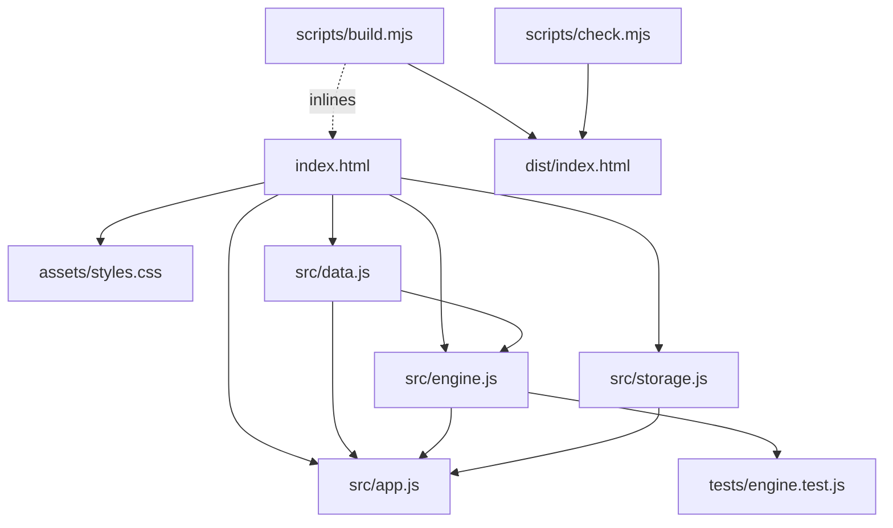
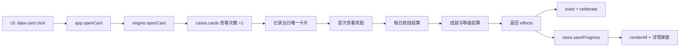
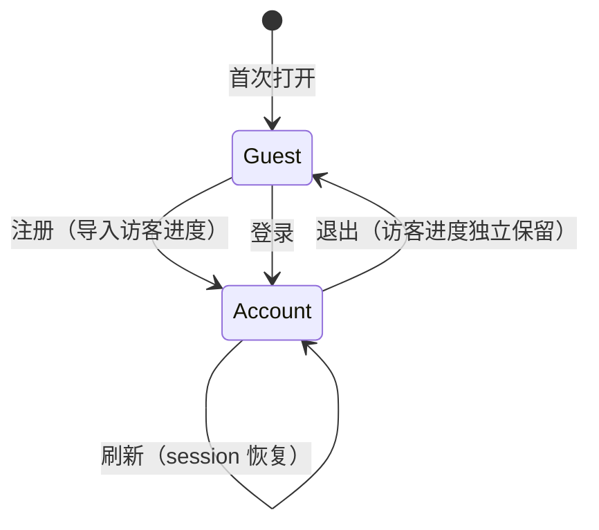

# 代码导图

## 1. 文件地图

| 文件 | 规模 | 责任 | 被谁调用 |
| --- | ---: | --- | --- |
| `index.html` | 83 行 | 页面骨架、语义区块、弹窗与入口脚本顺序 | 浏览器 |
| `assets/styles.css` | 56 KB | 暗夜营地视觉系统、像素边框、响应式布局 | `index.html` / 构建器 |
| `src/data.js` | 612 行 | 30 张知识卡、8 个成就、4 个奖励、等级名称 | 学习引擎、UI、测试 |
| `src/engine.js` | 537 行 | 学习状态迁移、奖励去重、每日委托、成就、等级 | UI、Node 测试 |
| `src/storage.js` | 101 行 | 账号、会话、按学习者分隔的进度存取 | UI |
| `src/app.js` | 103 行 | 页面渲染、路由、账号表单、事件委托、toast | 浏览器 |
| `scripts/build.mjs` | 75 行 | 将源文件内联为单文件并二次校验 | 发布流程 |
| `tests/engine.test.js` | 167 行 | 10 条学习领域规则测试 | `npm test` |
| `tests/storage.test.js` | 52 行 | 4 条仓储、隔离与失败回退测试 | `npm test` |
| `dist/index.html` | 生成物 | 自包含、可离线交付的最终页面 | 终端用户 |

## 2. 依赖方向



约束：

- `engine.js` 不得导入/访问 DOM、`window`、`localStorage`；
- `data.js` 不得包含奖励判定函数；
- `app.js` 不得直接修改奖励、成就、连续天数或等级；
- `storage.js` 不得知道学习规则；
- `dist/` 只能由 `npm run build` 生成，不手改。

## 3. 主流程

### 3.1 翻开知识卡



### 3.2 掌握、打卡与宝箱

- `engine.setStatus({status:'mastered'})`：只有 `masteredAt` 不存在时，才发放首次掌握奖励、计入当日掌握数并结算每日航线；切回学习中再掌握不会重复。
- `engine.checkIn`：同日重复调用返回 `already-checked-in`，不改变 XP。
- `engine.openChest`：要求当日 3 项委托全部完成，并且 `chest:YYYY-MM-DD` 未在账本中；开箱后不可重复。
- `engine.redeem`：余额、一次性权益、可重复权益和兑换流水都在同一个操作里完成。

### 3.3 账号切换



所有账号的进度使用独立键：`zhiyu.progress.v1.<userId>`；访客使用 `zhiyu.guest.v1`。

## 4. 进度状态

```text
version, xp, coins, lastLevel, createdAt
profile { name, bio, theme }
cards[cardId] { views, status, lastView, masteredAt? }
checkins[YYYY-MM-DD] { ts }
daily[YYYY-MM-DD] { views[], mastered[] }
achievements[achievementId] = unlockedAt
awarded[rewardKey] = grantedAt          # 幂等账本
rewards[rewardId] = count
redemptions[] { id, rewardId, name, cost, ts }
transactions[] { id, ts, label, xp, coins, balance }
```

`awarded` 是奖励幂等性的核心：所有一次性奖励都通过带唯一键的 `grant()` 写入，重复事件不会再次改变 XP 或叶币。

## 5. 规则索引

| 规则 | 实现 | 测试 |
| --- | --- | --- |
| 首次查看 +5 XP / +1 叶币 | `engine.openCard` | `opening a card...` |
| 查看三张不同卡 +30 / +10 | `engine.settleDaily` | `three cards...` |
| 首次掌握 +15 / +4 | `engine.setStatus` | `mastery bonus...` |
| 掌握一张卡 +25 / +8 | `engine.settleDaily` | `three cards...` |
| 打卡 +20 / +10 | `engine.checkIn` | `three cards...` |
| 全航线 +40 / +15 | `engine.settleDaily` | `three cards...` |
| 宝箱 +20 / +10 | `engine.openChest` | `daily chest...` |
| 成就 automatic grant | `engine.evaluateAchievements` | `streak...` |
| 等级阈值 | `engine.levelInfo` | `levels use...` |
| 余额与一次性权益 | `engine.redeem` | `rewards enforce...` |

## 6. 扩展位置

- **新增知识卡**：只改 `src/data.js` 的 `cards`，保证 `id` 唯一，并包含 `title/summary/core/pitfall/question/answer/source`。
- **新增成就**：在 `ACHIEVEMENTS` 增加声明式定义，`metric` 必须是 `uniqueCards | subjectsSeen | mastered | streakPeak | level`。
- **新增奖励**：在 `REWARDS` 增加项；如需装扮副作用，在 `renderProfile` 或场景渲染中读取 `state.rewards[rewardId]`。
- **新增存储后端**：实现与 `createStore` 相同的接口，替换 `app.js` 中的注入实例；学习引擎无需修改。
- **修改等级曲线**：只改 `engine.levelInfo`，并增补边界测试。
