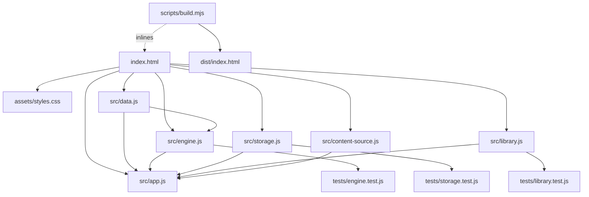
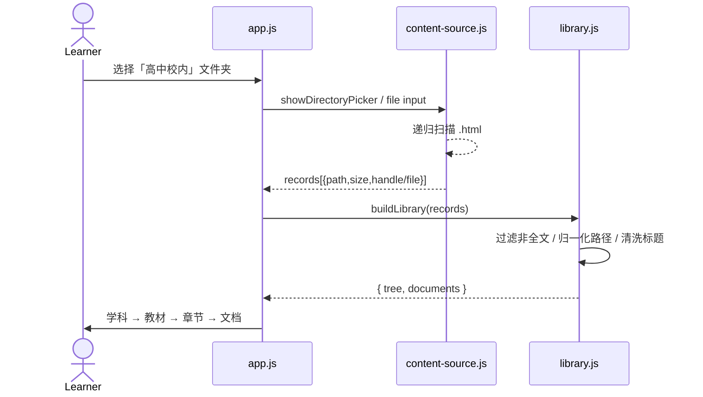
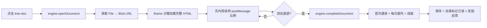

# 代码导图

## 1. 文件地图

| 文件 | 责任 | 被谁使用 |
| --- | --- | --- |
| `index.html` | 页面骨架、目录树、全文阅读器、弹窗 | 浏览器 |
| `assets/styles.css` | 暗夜营地、目录树、阅读器、角色卡和响应式 | 页面 / 构建器 |
| `src/data.js` | 五个学科、8 个成就、4 个奖励、等级名称 | 引擎、UI、测试 |
| `src/engine.js` | 通读、每日委托、连续打卡、成就、等级与兑换规则 | UI、Node 测试 |
| `src/storage.js` | 账号、会话、按学习者隔离的进度存取 | UI |
| `src/library.js` | 文件路径过滤、标题清洗、分层目录和搜索 | UI、测试 |
| `src/content-source.js` | 目录句柄、FileList、Blob 读取、IndexedDB 句柄 | UI |
| `src/app.js` | DOM 渲染、科目大纲、星图导航、阅读器滚动桥、账号、事件 | 浏览器 |
| `scripts/build.mjs` | 将源文件内联为单文件并二次编译校验 | 发布流程 |
| `tests/*.test.js` | 领域、索引、仓储共 23 条测试 | `npm test` |
| `dist/index.html` | 约 211 KB 的自包含应用外壳 | 终端用户 |

## 2. 依赖方向



约束：

- `engine.js` 不访问 DOM、`window`、`localStorage` 或文件系统；
- `library.js` 只接收路径，不读取或修改文件；
- `content-source.js` 只处理文件访问，不知道奖励；
- `app.js` 只上报“滚动到达底部”，不自行计算 XP；
- 完整复习文件不被写入 `localStorage`；
- `dist/` 只能由 `npm run build` 生成。

## 3. 目录导入流程



### 过滤规则

纳入：

- 五科目录下的完整 HTML；
- 全书合订本、全书速览、分章整理、示意图总览、重点速记、专题资料。

排除：

- `原页总览`、`讲义原页`、`打印版`、`无插图版`；
- `绘图工具`、`原稿备份`、`_work`、`pdf_pages` 等中间目录；
- 非五科目录、Markdown、PDF、图片。

当前实测：**110 个 HTML → 99 篇复习资料 → 50 个层级目录**。

## 4. 两种导航

```mermaid
flowchart LR
  LIB[library.tree] --> OUTLINE[Outline：科目 tab + 折叠树]
  LIB --> GRAPH[星图：当前层 + 子节点]
  OUTLINE --> DOC[openDocument(path)]
  GRAPH -->|点击分支| GRAPH
  GRAPH -->|点击文档| DOC
  DOC --> READER[完整 HTML 阅读器]
```

- 星图层级只存在于 `graphTrail`，不进入 `state`；
- 分支点击进入下一层，面包屑可跳回任意祖先；
- 文档节点与大纲共用 `openDocument(path)`；
- 返回星图时保留之前的层级和面包屑。

## 5. 通读流程



完成条件：

- 文档根滚动区或大型内部滚动容器到达约 98.5%；
- 短文档无法滚动时，停留约 2.8 秒；
- 父页面校验 `postMessage` 的 iframe source 与一次性 token；
- 同一阅读会话只触发一次 `completeDocument`；
- 阅读桥没有回传时显示明确提示，不伪造完成。

## 6. 进度状态

```text
version=3, xp, coins, lastLevel, createdAt
profile { name, bio, theme }
documents[path] {
  opens, reads, lastOpen, lastRead, title, subject
}
checkins[YYYY-MM-DD] { ts }
daily[YYYY-MM-DD] { reads: [path] }
achievements[id] = unlockedAt
awarded[key] = grantedAt
rewards[id] = count
redemptions[] / transactions[]
```

阅读相关的幂等键：

- `read:<path>`：一篇资料的首次通读奖励；
- `quest:read1:<day>`：当天第一篇完成委托；
- `quest:read2:<day>`：当天第二篇完成委托；
- `quest:all:<day>`：当天全部委托；
- `chest:<day>`：当天宝箱；
- `achievement:<id>`：成就。

## 7. 规则索引

| 规则 | 实现 | 测试 |
| --- | --- | --- |
| 打开不奖励 | `engine.openDocument` | `opening a document...` |
| 首次通读 +15 / +4 | `engine.completeDocument` | `completing a document...` |
| 重读不重复发首次奖励 | `awarded['read:<path>']` | `re-reading...` |
| 每日第一篇 +30 / +10 | `engine.settleDaily` | `two distinct documents...` |
| 每日第二篇 +25 / +8 | `engine.settleDaily` | `two distinct documents...` |
| 打卡 +20 / +10 | `engine.checkIn` | `two distinct documents...` |
| 全航线 +40 / +15 | `engine.settleDaily` | `two distinct documents...` |
| 宝箱 +20 / +10 | `engine.openChest` | `daily chest...` |
| 五科成就 | `engine.evaluateAchievements` | `five subjects...` |
| 兑换余额与权益 | `engine.redeem` | `rewards enforce...` |
| 目录过滤 / 标题 / 层级 | `library.js` | 7 条 `library.test.js` |

## 8. 扩展位置

- **增加筛选规则**：改 `src/library.js` 的 `SKIPPED_FOLDERS` / `SKIPPED_FILE`，并补目录测试。
- **新增成就**：在 `src/data.js` 增加声明式定义；`metric` 只能是 `documents`、`subjectsSeen`、`streakPeak`、`level`。
- **新增角色装扮**：在 `assets/characters/` 增加原创 SVG，并让场景或角色卡引用对应 reward ID。
- **新增存储后端**：实现与 `createStore` 同接口的模块并注入 `app.js`；引擎不需要改。
- **修改完成判定**：集中修改 `src/app.js` 的 `readerScrollMetrics` 与文档中的完成条件，不要改引擎奖励接口。
- **增加浏览器烟测**：用 `tests/fixtures/高中校内/` 作为最小资料库，验证导入 → 展开 → 打开 Blob iframe → 滚到底 → 奖励。
